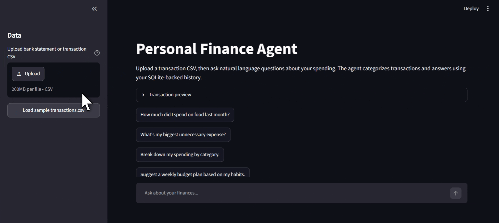

# Personal Finance Agent

> Local-first financial copilot for CSV/PDF statement ingestion, daily expense journaling, budget tracking, anomaly detection, and natural language spending analytics. Powered by Rust, embedded SQLite, and React.

## Overview

Personal Finance Agent is a full-stack, local-first financial management platform compiled into a single executable binary.

- **Backend (`src/`)**: Rust 1.75+ with Axum, Tokio, embedded SQLite (`rusqlite`), PDF/CSV extraction (`pdf-extract`, `csv`), and a native OpenAI-compatible tool-calling LLM loop.
- **Frontend (`frontend/`)**: React 18, TypeScript, Vite, Tailwind CSS dark-mode workspace, Recharts visualizations, and Lucide icons embedded directly into the Rust binary via `rust-embed`.
- **Privacy**: Transaction and budget data are stored locally in `finance.db` with strict read-only SQL enforcement (`SELECT` only) for AI tool calls.

## Demo



## Features

- **Analytics Dashboard**: Category outflow bar chart, cumulative spending curve, KPI summary cards, and interactive dark-mode visualizations.
- **Monthly Category Budgets & Overspend Alerts**: Configure per-category spending ceilings in SQLite with real-time progress bars (`Within Target`, `Near Limit`, `Over Budget`) and over-budget banners.
- **Spending Spike & Anomaly Detection**: Statistical outlier engine computes per-category mean and Z-score deviations (`>= 2.0` Z-score or `>= 2.2x` category average) and flags abnormal charges on the Dashboard.
- **Date Range Filtering**: Top-bar period selector (`All Time`, monthly presets, `Last 30 Days`) scopes dashboard metrics, charts, budgets, anomalies, and exported statements.
- **Daily Expense Journal**: Grouped daily timeline with search, category filter pills, and a quick-entry **Log Daily Expense** modal with automatic merchant categorization.
- **Recurring Subscriptions & Bill Tracker**: Detects repeating merchant charges across billing cycles to calculate fixed monthly burn and projected annual cost.
- **Multi-Format Ingestion**: Drag-and-drop upload for bank CSVs (flexible column mapping for date, description, amount, debit/credit) and PDF bank statements, plus sample dataset loading.
- **CSV, JSON & PDF Statement Exports**: Date-scoped CSV downloads, structured JSON audit exports, and a print-ready Financial Statement modal (`Save as PDF`).
- **AI Chat Copilot**: Natural language Q&A with 8 local SQL and financial analysis tools. Supports Orq.ai, OpenAI-compatible APIs, and zero-config local Ollama auto-detection.

## Tech Stack

| Layer | Technology |
| --- | --- |
| Backend | Rust (1.75+), Axum 0.7, Tokio, Tower-HTTP, Serde, Reqwest, Anyhow |
| Database | Embedded SQLite (`rusqlite` with bundled SQLite) |
| Ingestion | `csv`, `pdf-extract`, `chrono`, `regex` |
| Frontend | React 18, TypeScript 5, Vite 6, Tailwind CSS 3, Recharts, Lucide React |
| Packaging | Single binary serving embedded SPA assets via `rust-embed` |

## Directory Structure

```text
personal_finance_agent/
├── Cargo.toml                  # Rust crate configuration and dependencies
├── build.rs                    # Ensures frontend/dist exists during Cargo builds
├── .env.example                # LLM provider and port environment template
├── transactions.csv            # Sample multi-month transaction dataset
├── src/
│   ├── main.rs                 # Axum server, REST endpoints, static asset fallback
│   ├── lib.rs                  # Public library crate exports
│   ├── models.rs               # Shared Serde DTOs (transactions, budgets, anomalies)
│   ├── db.rs                   # SQLite schema, CRUD, budgets, subscriptions, anomalies
│   ├── categories.rs           # Keyword categorization dictionary and rules
│   ├── ingest.rs               # CSV column normalizer and PDF text parser
│   └── agent.rs                # OpenAI-compatible tool-calling loop & Ollama fallback
├── frontend/
│   ├── package.json            # Frontend dependencies and Vite scripts
│   └── src/
│       ├── App.tsx             # Landing page, Dashboard, Journal, Chat, Subscriptions, Modals
│       └── index.css           # Tailwind base styles and print stylesheet for PDF export
└── tests/
    └── integration_tests.rs    # Ingestion, SQLite, budgets, date filters, anomaly tests
```

## Quick Start

### Prerequisites

- [Rust](https://rustup.rs/) (1.75+)
- [Node.js](https://nodejs.org/) (18+)
- An API key for Orq.ai (`ORQ_API_KEY`), OpenAI (`OPENAI_API_KEY`), or a local [Ollama](https://ollama.com/) instance running on port `11434`

### 1. Build Frontend Assets

```bash
cd frontend
npm install
npm run build
cd ..
```

### 2. Configure Environment

```bash
cp .env.example .env
```

Set a provider in `.env` (or leave unset to auto-detect local Ollama at `http://localhost:11434`):

```env
# Orq.ai (default)
ORQ_API_KEY=your-orq-api-key-here
# ORQ_BASE_URL=https://api.orq.ai/v3/router
# ORQ_MODEL=deepseek-v4-flash

# Or OpenAI / compatible endpoint (Groq, OpenRouter, etc.)
# OPENAI_API_KEY=your-api-key-here
# OPENAI_BASE_URL=https://api.openai.com/v1
# OPENAI_MODEL=gpt-4o-mini

# Server port (default: 8501)
# PORT=8501
```

### 3. Run the Application

```bash
cargo run
```

Open [http://localhost:8501](http://localhost:8501) in your browser.

For frontend hot-reload development alongside the Rust API server:

```bash
# Terminal 1: Rust backend on :8501
cargo run

# Terminal 2: Vite dev server on :5173 (proxies /api -> :8501)
cd frontend && npm run dev
```

## API Endpoints

| Method | Endpoint | Description |
| --- | --- | --- |
| `GET` | `/api/health` | Health check (`OK`) |
| `GET` | `/api/transactions` | List transactions (supports `?start_date=&end_date=`) |
| `POST` | `/api/transactions` | Log a single daily expense with auto-categorization |
| `GET` | `/api/summary` | Total spending, count, date range, category breakdown |
| `GET` | `/api/trends` | Daily and cumulative spending time series |
| `GET` | `/api/budgets` | Category budgets with spent amount, percentage, and status |
| `POST` | `/api/budgets` | Create or update a monthly category ceiling |
| `GET` | `/api/subscriptions` | Detect recurring merchant charges and cadence |
| `GET` | `/api/anomalies` | Detect statistical outlier transactions and spikes |
| `POST` | `/api/upload` | Ingest uploaded CSV or PDF bank statement |
| `POST` | `/api/sample` | Load bundled `transactions.csv` demo dataset |
| `POST` | `/api/clear` | Clear stored transactions from `finance.db` |
| `GET` | `/api/export/csv` | Download filtered transactions as CSV |
| `GET` | `/api/export/json` | Download filtered summary and transactions as JSON |
| `POST` | `/api/chat` | Send a question with history to the AI finance copilot |

## AI Agent Tools

When answering questions in **Chat Copilot**, the agent calls local read-only functions implemented in `src/agent.rs`:

- `query_transactions_sql`: Executes validated read-only `SELECT` queries against SQLite.
- `summarize_spending`: Aggregates spending for `all`, `this_month`, `last_month`, or `last_7_days`.
- `get_category_spending`: Computes category totals and shares.
- `suggest_weekly_budget`: Generates weekly spending caps with a 10% trim on discretionary categories.
- `find_largest_discretionary_expenses`: Lists top expenses in Food, Shopping, and Entertainment.
- `check_budget_alerts`: Evaluates stored SQLite category budgets for warnings or overruns.
- `detect_recurring_subscriptions`: Identifies repeating charges and total fixed monthly burn.
- `detect_spending_anomalies`: Flags abnormal spending spikes and Z-score outliers.

## Running Tests

```bash
cargo test
```

Runs 3 unit tests in `src/categories.rs` and 6 integration tests in `tests/integration_tests.rs`.
